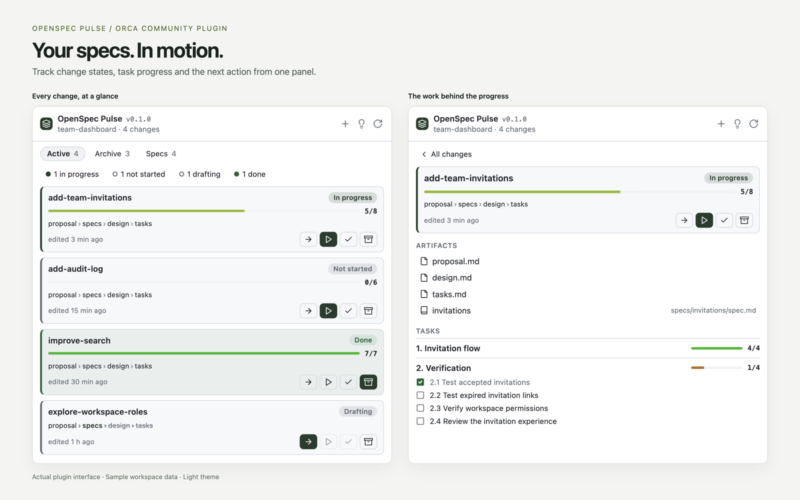
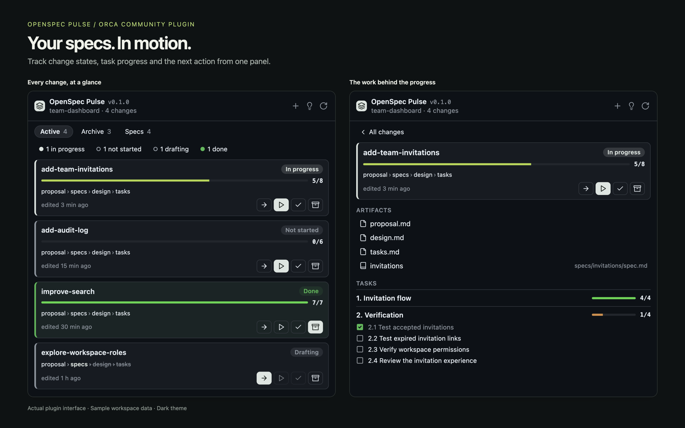
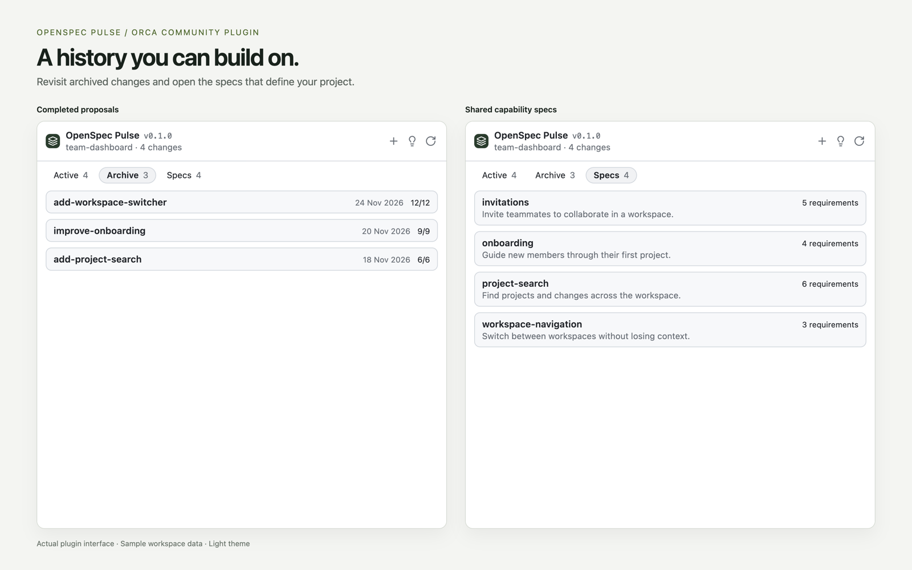

# OpenSpec Pulse


**Your OpenSpec workflow, in Orca's sidebar.** Track proposals, follow task progress,
review archived changes and open shared specs without leaving your workspace.

See the [OpenSpec](https://github.com/Fission-AI/OpenSpec) changes of the focused workspace in
Orca's right sidebar: the active ones coloured by state with the one action that moves each forward,
the archived ones, and the workspace's specs. A status bar item keeps the summary in view with the
panel closed. Requires Orca 1.4.259 or later in the desktop app, and a local workspace: SSH and WSL
workspaces are not read.





These captures show the actual panel code with sample data in a presentation frame.
They do not include personal workspaces or conversations.

## Install

### From GitHub or the marketplace

Once the first version tag is published, search for **OpenSpec Pulse** in Orca's plugin
directory, or install directly from GitHub:

```sh
orca plugin install Dos2Locos/openspec-pulse
```

Orca displays the plugin's access and an approval fingerprint. Review it, then rerun the
command with the exact `--approve <fingerprint>` it returns. Open **OpenSpec** in the right
sidebar, or use **OpenSpec Pulse: Show panel** from the command palette.

### From a local checkout

Turn plugins on in Orca (Settings → Plugins → **Turn on plugins**), then either add this folder
under Settings → Plugins → **Development folders…** and enable it, or from a terminal:

```sh
orca plugin dev load .                     # prints an approval fingerprint
orca plugin dev load . --approve <fingerprint>
orca plugin open local.openspec-pulse      # shows the panel in the right sidebar
```

`orca plugin dev unload .` removes it. The plugin runs its own code in a worker and asks for
`workspace:read`, `workspace:write`, `agent:read`, `terminal:send` and `storage:own`; Orca shows
the list before you approve. This is a community plugin, independently maintained and not
affiliated with or endorsed by Orca or OpenSpec.

### Requirements

- Orca desktop **1.4.259+**, with plugins enabled and a local workspace.
- An existing `openspec/` workspace for browsing changes and specs. No OpenSpec CLI is
  needed just to read it.
- The [OpenSpec CLI](https://github.com/Fission-AI/OpenSpec) for **Initialize OpenSpec**.
- Claude Code, configured in Orca, and the OpenSpec Claude skills for the agent buttons
  (`openspec init --tools claude` in your project).

### Access and privacy

The worker runs with your user account's access. Its declared capabilities let it read the
focused workspace and agent status, open files and focus terminals, send OpenSpec prompts,
and remember the selected change in its own storage. The plugin reads local `openspec/`
files; initialization runs the OpenSpec CLI and agent buttons send prompts to Claude Code.
It has no analytics or telemetry. Claude Code uses your configured account and service.

## The panel

The header shows the plugin name and version and a subtitle with the workspace and its situation
(`rabbitfish · 2 changes`, `No OpenSpec here`, `remote`, `No workspace`). On the right, icon
buttons: **+** (new proposal), **Explore** and **Refresh**. Without OpenSpec, or in a remote
workspace, + and Explore are disabled.

Under it, three tabs with their counts: `Active 2 · Archive 5 · Specs 3`. They show when the
workspace has OpenSpec, are plain buttons (Tab to one, then Enter or Space) and give way to a
detail's own back button. A workspace switch returns to `Active`. Everything refreshes by itself
when a file under `openspec/` changes, so archiving a change moves it from `Active` to `Archive`
without pressing Refresh.

### Active

A summary strip with one item per state that has changes, such as `● 2 in progress  ● 1 done`.
Pressing an item lists only that state's changes; pressing it again lists them all. Below it, one
card per change, most recently edited first:

| Part | What it says |
| --- | --- |
| Stripe and pill | The state: `Drafting` (no tasks yet), `Not started` (0 done), `In progress` or `Done`. |
| Progress bar | `done/total` of the `tasks.md` checkboxes, from red (0%) through yellow to green (100%); drafting changes have none. |
| Stepper | `proposal › specs › design › tasks`: done, missing (struck through) or next (bold). |
| `edited … ago` | The newest file in the change folder; kept current while the panel is open. |
| Action buttons | Continue, apply, verify and archive as icons (the tooltip names each). The next step is filled: continue while planning, apply while tasks are pending, archive when all are done. Apply and verify need tasks. |

The stripe, pill and strip dots show the state: in progress uses the theme's primary colour, done a
green (`#166534` light, `#3fb950` dark), not started and drafting the muted text colour. The pill
always names the state, so colour is never the only signal. The panel uses Orca's `--orca-*` theme
variables and follows theme switches without reloading.

Pressing a change's name opens its detail: its card, its artifacts and each
`specs/<capability>/spec.md` (press one to open it in Orca's editor), and its tasks grouped by their
`tasks.md` heading, each section with its own bar and each task with a checkbox (read-only). The
open change is remembered per workspace.

### Archive

The folders of `openspec/changes/archive/`, newest first: the change name, its archive date (from
the `YYYY-MM-DD-` prefix) and its final `done/total`. A row opens the same detail as an active
change, read-only: an `Archived 26 Nov 2026` pill, a muted stripe, no action buttons, and files
that open in Orca's editor.

### Specs

The capabilities of `openspec/specs/`, sorted by name: the capability, the first line of its
`## Purpose` and `N requirements`. A row opens its `spec.md` in Orca's editor. With none, the tab
says that archiving a change creates them.

## Agent commands

+ and Explore open a form for the first prompt (Cmd+Enter starts it). The action buttons send
`/openspec-continue-change`, `/openspec-apply-change`, `/openspec-verify-change` or
`/openspec-archive-change <change>`; + and Explore send `/openspec-propose <prompt>` or
`/openspec-explore <prompt>`. The command goes to a Claude Code terminal of the workspace that is
idle at its prompt (state `done`, with a tab), which is then shown; without one, a new Claude chat
opens in the current window. These are the skills `openspec init --tools claude` (or a global
install) gives Claude Code. Buttons send a prompt to the agent; its behavior and approval requests
follow your Claude Code configuration.

A workspace without `openspec/changes/` offers **Initialize OpenSpec**, which runs
`openspec init --tools none --no-animation .` in the workspace root: it only creates `openspec/`
(config, `specs/`, `changes/`), no agent files. The `openspec` CLI must be in `~/.local/bin`,
`/opt/homebrew/bin`, `/usr/local/bin` or Orca's PATH.

## The status bar item

It shows the `layers` icon and the number of active changes with their tasks, such as
`2 changes · 5/12` (`2 changes` when none has tasks, `No changes` with only the archive). Its tone
is `accent` while tasks are pending, `success` when all are done and `neutral` otherwise. The
tooltip lists each change with its `done/total` or `no tasks`. It is hidden with no workspace, in
SSH and WSL workspaces and without `openspec/changes/`, and it counts active changes only.

It follows workspace switches and file changes with the panel closed: the worker keeps running
while the plugin is enabled. Pressing it shows the panel in the right sidebar, opening the sidebar
if it is closed (the worker runs `orca plugin open <key> --panel changes`; if that fails,
`orca plugin logs local.openspec-pulse` says why).

## What is in this folder

- `orca-plugin.json`: what Orca loads. A `trusted-worker` manifest with one html panel, the status
  bar item, the `openspec-pulse.showPanel` command and the `workspace.changed` event.
- `src/worker.ts`: resolves the focused workspace, reads and watches `openspec/`, updates the
  status bar, calls `editor.open` and starts agents. Sandboxed panels cannot read files, and only
  workers may call `editor.open` and `statusBar.update`, which is why the worker exists.
- `src/openspec.ts`: reads the changes, the archive and the specs from disk, counts checkboxes and
  requirements, and finds each change's newest file. Plain Node, no Orca API.
- `src/state.ts`: state, stepper, next step, action buttons, bar hue, strip counts, ages and the
  status bar summary, plus the contrast check of the state colours. Pure, shared by panel and
  worker.
- `src/commands.ts`: builds and validates the slash command each button sends, and picks the plugin
  key to open the panel.
- `src/protocol.ts`: the types panel and worker share (`changes.list`, `changes.detail`,
  `changes.open`, `archive.list`, `archive.detail`, `specs.list`, `specs.open`, `agent.run`,
  `openspec.init`, `changes.changed`).
- `src/panel/`: the html panel, in TypeScript with no build step (Orca transpiles it). `main.ts`
  holds the state, worker calls and redraws; `views.ts` the header, tabs, cards and lists;
  `detail.ts` the detail of an active or archived change; `dom.ts` the `h()` builder, which only
  sets text through text nodes, and the icons; `model.ts` the state and action types; `text.ts`
  the task text helpers and dates; `panel.css` the styles.
- `openspec/`: the project's own OpenSpec specs and changes, and
  [`docs/PROPUESTAS-DE-CAMBIO.md`](docs/PROPUESTAS-DE-CAMBIO.md), the order of the change proposals.
- `fixtures/sample/`: a small OpenSpec workspace for trying the panel.

The agent buttons and the status bar press run Orca's own CLI (`orca agent launch --surface chat
--focus` and `orca plugin open`, found inside Orca.app or on PATH): the host API cannot open a chat
or a panel.

## Develop

```sh
npm install           # only TypeScript and @types/node, for type-checking
npm run typecheck     # writes Orca's typings to .orca/types and runs tsc
npm test              # orca plugin test .: the *.test.ts files under src/, in Node
npm run validate      # orca plugin validate .
npm run media:preview # local, reproducible gallery of the real panel with sample data
orca plugin dev watch .   # loads the folder, prints logs and reloads on save
```

While the folder is loaded:

```sh
orca plugin dev request . changes.list                          # what the panel receives
orca plugin dev request . archive.list                          # the Archive tab
orca plugin dev request . specs.list                            # the Specs tab
orca plugin dev request . changes.detail --data '{"name":"<change>"}'
orca plugin shot local.openspec-pulse --theme light             # PNG of the panel in .orca/shots/
orca plugin shot local.openspec-pulse --status-bar              # the status bar row
orca plugin logs local.openspec-pulse
```

`orca plugin shot --theme` only applies with Orca's window hidden. `orca plugin check` renders
components panels only, so the html panel is checked by eye with `orca plugin shot`; its logic lives
in `src/state.ts` and `src/openspec.ts`, which `npm test` covers. The worker test runs the real
`openspec init` when the CLI is installed.

Panel and worker reload on save without a new approval; adding a capability, a command, an event or
a status bar item asks again. Reference:
[Orca plugin authoring](https://github.com/stablyai/orca/blob/main/docs/reference/plugin-authoring.md).

## Publishing and support

Release steps, marketplace metadata and image provenance are in
[the publication guide](docs/PUBLISHING.md). Report bugs or request features in
[GitHub Issues](https://github.com/Dos2Locos/openspec-pulse/issues), including the Orca and
plugin versions and the relevant plugin logs (remove private paths and prompts first).

Licensed under [MIT](LICENSE).
