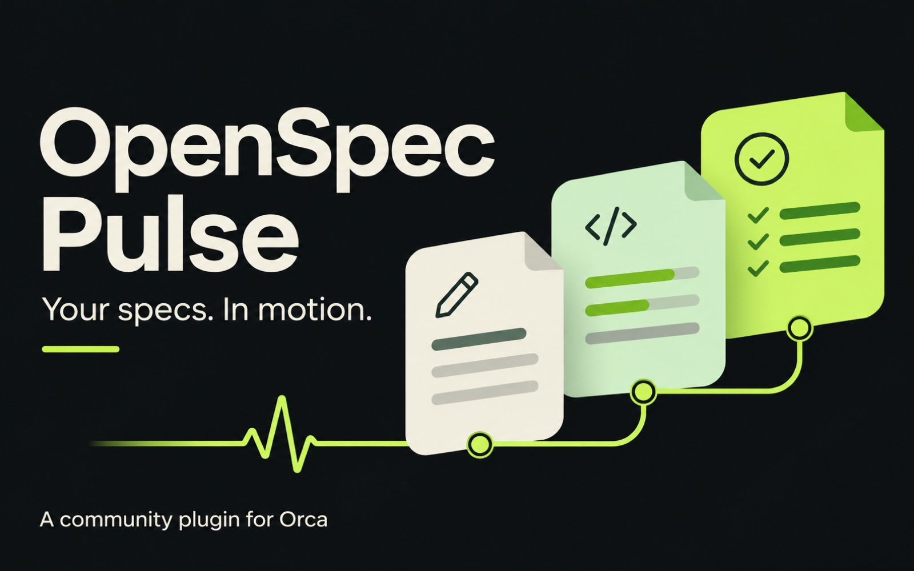

# OpenSpec Pulse



**Your OpenSpec workflow, in Orca's sidebar and main-area board.**

Follow proposals from planning to archive, review task progress and specs, and send the next
action to **Claude Code or Codex** after reviewing its exact prompt and destination.

## What you can do

- **Track changes:** state filters, task progress, next actions, search, dependency order and
  workspace-local favorites.
- **Read in context:** artifact previews, archived proposals, specs and related changes.
- **Review usage:** local Claude Code/Codex tokens and estimated API-equivalent USD, with
  separate optional project run records.
- **Follow your language:** English, Spanish (Spain) and Simplified Chinese, matching Orca.
- **Work in either view:** a compact sidebar or a main-area board with four state columns.
- **Choose the scope:** the focused workspace, registered sibling worktrees or shared OpenSpec
  stores with explicit system prefixes.
- **Review before sending:** choose an agent and an idle destination, run a whole change or one
  pending task, and optionally display configured ticket links and GitHub PR delivery status.

Task completion and PR delivery are separate signals. Sibling worktrees and shared-store changes
are read-only for agent actions. The Spend tab shows local Claude Code/Codex usage and optional
project run records, with coverage and estimated API-equivalent USD.

## Install

Enable plugins in Orca under **Settings → Plugins → Turn on plugins**. Install the latest
tagged release from GitHub:

```sh
orca plugin install Dos2Locos/openspec-pulse
```

Review the access request and rerun the command with the exact
`--approve <fingerprint>` Orca returns. Open **OpenSpec** in the right sidebar, or run
**OpenSpec Pulse: Show panel** from the command palette.

For the main-area view, use **OpenSpec Pulse: Open board**. The board requires a Git workspace
where `.orca/openspec.pulse-board` is already ignored; adding `.orca/` to `.gitignore` is enough.

The directory installs the tagged release. This README on the default branch can describe
changes prepared for the next release; see [CHANGELOG.md](CHANGELOG.md).

### Requirements

| Feature | Requirement |
| --- | --- |
| Sidebar and local browsing | Orca desktop **1.4.259+**, plugins enabled, a local OpenSpec workspace |
| Agent actions | Claude Code or Codex configured in Orca, with the corresponding OpenSpec skills installed |
| Initialize OpenSpec | The OpenSpec CLI available locally |
| Board and sibling discovery | Git available outside the workspace; the board marker path must be ignored |
| Shared stores | The tested **OpenSpec CLI 1.14.1** store contract on macOS |
| Optional GitHub delivery | GitHub CLI, configured repositories/tickets and an explicitly selected local account |

Reading local changes and specs does not require the OpenSpec CLI. SSH and WSL workspaces are
not supported. Store operations are disabled with an explanation when the CLI contract is
incompatible; local browsing remains available.

Install agent skills in your project with `openspec init --tools claude` or
`openspec init --tools codex`, as appropriate for your agent and CLI version.

## First use

1. Open a local workspace with `openspec/` and select **OpenSpec** in the right sidebar.
2. Choose **Active**, **Archive** or **Specs** to browse work, **Stores** to manage shared
   stores, or **Spend** to review usage. Labels follow Orca’s language.
3. For an active local change, choose an action, review its agent, destination and prompt, then
   press **Send/Start**.

Without an OpenSpec root, the panel offers **Initialize OpenSpec**. This creates the planning
folders through the CLI; install agent skills separately.

For configuration examples and feature limits, see the [usage guide](docs/USAGE.md):
[dependencies](docs/USAGE.md#dependency-order-and-favorites),
[agent commands](docs/USAGE.md#agent-commands),
[project workflow](docs/USAGE.md#project-workflow-openspecpulsejson),
[tickets and PRs](docs/USAGE.md#tickets-pull-requests-and-delivery),
[board](docs/USAGE.md#main-area-board-and-artifact-previews) and
[shared stores](docs/USAGE.md#shared-openspec-stores).

Claude Code and Codex consumption appears automatically from local session usage metadata,
with tokens and estimated API-equivalent USD by agent, model and month. No generated records
or pulse.json are required. See [automatic consumption](docs/USAGE.md#automatic-claude-and-codex-consumption).
Explicit project JSONL logs remain an optional, separate [recorded-spend view](docs/USAGE.md#recorded-agent-spend).

## Access and privacy

Pulse is a **trusted-worker** community plugin: its worker runs with your user account's access.
Orca declares `workspace:read`, `workspace:write`, `agent:read`, `terminal:send` and `storage:own`
before installation approval.

Pulse reads local workspace/store files, watches the selected roots and stores local preferences.
For automatic consumption it also reads local agent usage metadata, matching sessions to selected
workspace paths. It does not interpret conversation content or read account credentials.
It can open files, create the ignored board marker, initialize OpenSpec, and link/unlink/create
local stores after a preview and confirmation. Agent actions send reviewed prompts through Orca
to your configured agent; that agent uses its own account and service.

Optional PR queries contact **github.com through GitHub CLI** using the explicitly selected
account. Without that configuration, local task browsing needs no GitHub connection. Pulse has
no analytics or telemetry. Shared-store changes cannot launch agents or open store files for
editing from the linked workspace.

This project is independently maintained and is not affiliated with or endorsed by Orca,
OpenSpec or the projects acknowledged below.

## Acknowledgements

Thank you to the authors and contributors whose OpenSpec plugins informed this project:

- **cmdaltctr**, [orca-plugin-openspec](https://github.com/cmdaltctr/orca-plugin-openspec)
  ([MIT](https://github.com/cmdaltctr/orca-plugin-openspec/blob/36cd6fe6efe160a1316eb814881ada19f379e0f8/LICENSE)):
  dependency ordering, sibling-worktree discovery and individual-task actions.
- **Ilya Bazylchuk (IBazylchuk)**,
  [orca-plugin-openspec-board](https://github.com/IBazylchuk/orca-plugin-openspec-board)
  ([MIT](https://github.com/IBazylchuk/orca-plugin-openspec-board/blob/bb0b92422717f7666285380e6c931f2dc53e67cf/LICENSE)):
  project-configured workflows and the separation of PR delivery from local task progress.
- **jameslatajan**, [orca-openspec](https://github.com/jameslatajan/orca-openspec)
  ([Apache-2.0](https://github.com/jameslatajan/orca-openspec/blob/6f714ae9755f4e4c9c3127414810ec7b625add87/LICENSE)):
  sidebar plus board, spec/change relationships, agent selection and shared-store workflows.

These are acknowledgements of design inspiration. The project research records independent
implementations rather than copied third-party source. Pinned revisions, license sources and
the reuse policy are in [ACKNOWLEDGEMENTS.md](ACKNOWLEDGEMENTS.md).

Thanks also to [Fission-AI and the OpenSpec contributors](https://github.com/Fission-AI/OpenSpec)
for OpenSpec, and [the Orca contributors](https://github.com/stablyai/orca) for the host platform.

## Develop and support

```sh
npm ci
npm run typecheck
npm test
npm run validate
npm run media:preview
```

For a local checkout, add the folder in **Settings → Plugins → Development folders…**, or run
`orca plugin dev load .` and review its approval request. Use
`orca plugin open local.openspec-pulse` to show the development panel.

Read the [publication guide](docs/PUBLISHING.md) and [release notes](docs/RELEASE-NOTES.md).
Report problems in [GitHub Issues](https://github.com/Dos2Locos/openspec-pulse/issues), including
Orca/plugin versions and relevant logs with private paths, prompts and credentials removed.

Licensed under [MIT](LICENSE).
