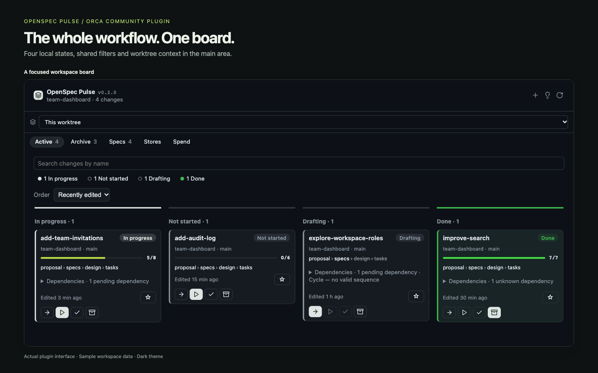
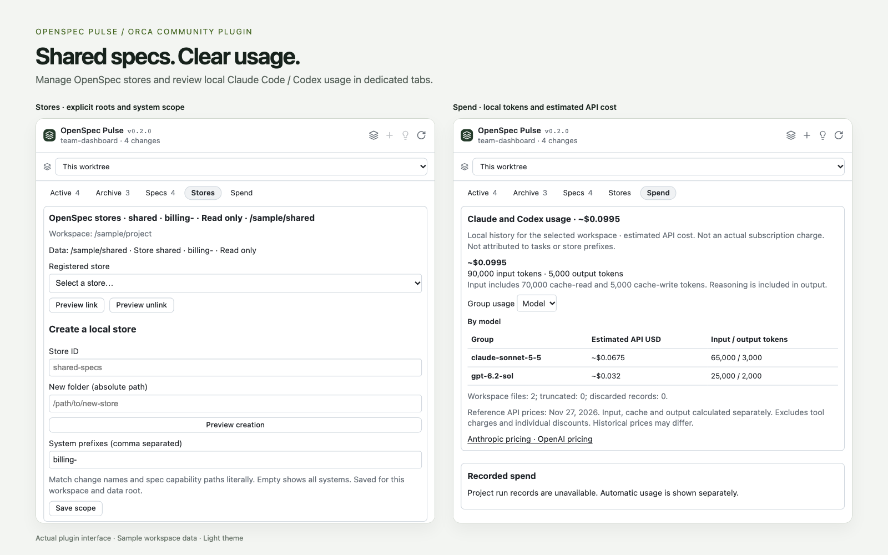
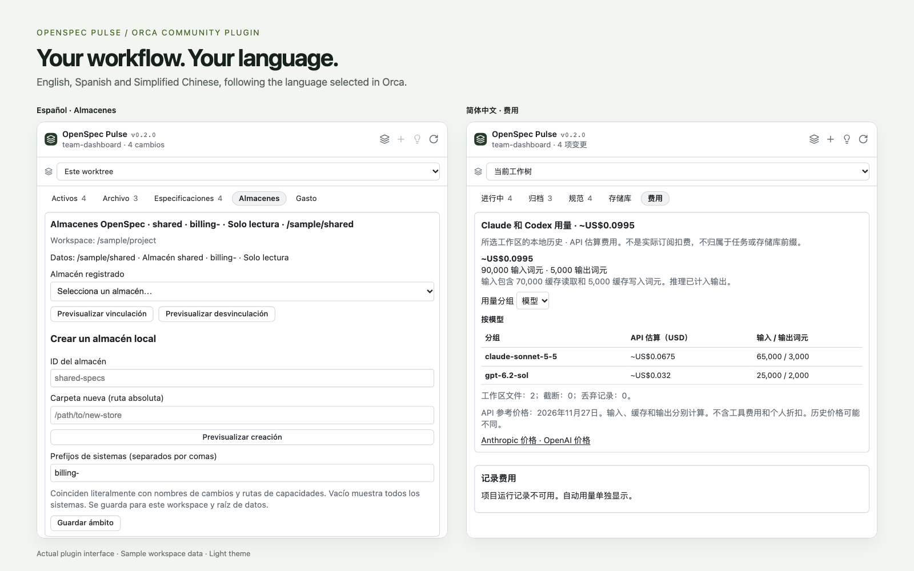

# OpenSpec Pulse 0.2.1

This patch puts the expanded screenshot gallery into the version-tagged manifest used by
Orca's marketplace. It contains the same runtime code and permissions as 0.2.0.

The six reviewed images include the main-area board, dedicated Stores and Spend tabs,
Spanish and Simplified Chinese UI, light/dark workflows, and archive/spec browsing.
All screenshots show actual plugin UI with synthetic sample data. Usage amounts are
sample API-equivalent estimates, not subscription charges.

## Main-area board

## Dedicated Stores and Spend tabs

## Spanish and Simplified Chinese

The 0.2.0 marketplace entry is awaiting maintainer code review. Local validation passes;
this patch makes the new gallery available for indexing but does not bypass that review.

[Usage guide](https://github.com/Dos2Locos/openspec-pulse/blob/v0.2.1/docs/USAGE.md)
