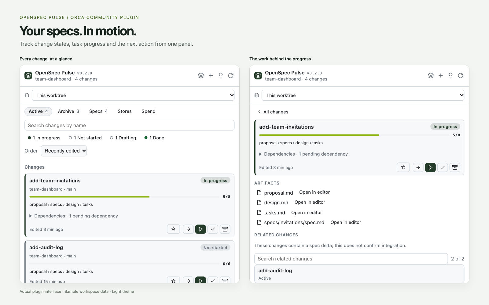
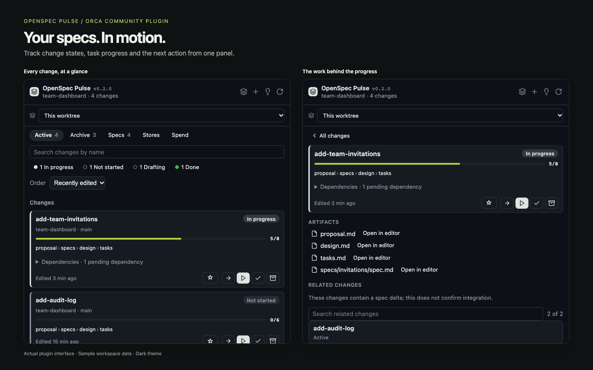
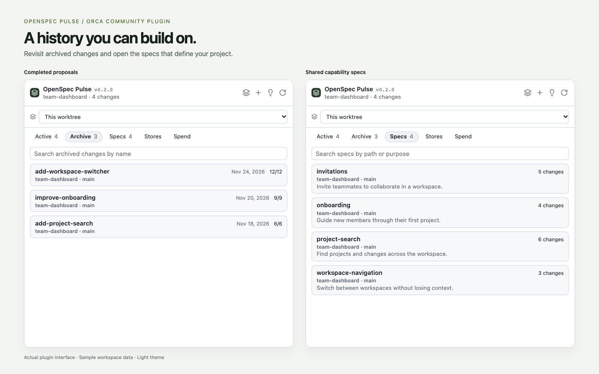

# Using OpenSpec Pulse

[Install and requirements](../README.md#install) · [Publishing](PUBLISHING.md)

## Sibling worktrees

Use the compact worktree selector for **This worktree**, a registered sibling, or **All worktrees**.
Pulse checks local workspaces registered in Orca using Git's canonical common directory. Matching
branch names in unrelated repositories do not qualify. Git must be installed outside the workspace
and available on PATH or in the standard installation folders. No Git CLI is needed for ordinary
focused-workspace browsing. Failed checks appear under a folded discovery-notices summary.

Active, Archive and Specs follow the selected scope; rows show workspace and branch, and identically
named changes from different worktrees stay separate. Search also matches the displayed origin.
File links open in the originating workspace. Agent actions and initialization are available only
for the focused workspace; **New proposal** and **Explore** require **This worktree**. Browsing never
switches Orca's focused workspace, and its status bar always summarizes only that workspace.

Use **Refresh** for sibling edits; the existing filesystem watcher follows the focused workspace.
Changing Orca's focused workspace resets the selector to **This worktree** and discards old reads.
The scope is kept only for the current panel session; no new persisted preferences or project files
are written. This feature uses the existing capabilities and Orca 1.4.259 APIs; no new host approval
is needed. Reverting the feature leaves all worktree data and existing preferences intact.

## The panel

The header shows the plugin name and version and a subtitle with the workspace and its situation
(`rabbitfish · 2 changes`, `No OpenSpec here`, `remote`, `No workspace`). On the right, icon
buttons: **+** (new proposal), **Explore** and **Refresh**. Without OpenSpec, or in a remote
workspace, + and Explore are disabled.

Under it, three tabs with their counts: `Active 2 · Archive 5 · Specs 3`. They show when the
workspace has OpenSpec, are plain buttons (Tab to one, then Enter or Space) and give way to a
detail's own back button. A workspace switch returns to `Active`. Everything refreshes by itself
when a file under `openspec/` changes, so archiving a change moves it from `Active` to `Archive`
without pressing Refresh.

Each list has a search box: Active and Archive match change names, Specs match the capability path
and Purpose. Case and accents are ignored (`autenticacion` finds `Autenticación`), every word must
match, and the state filter of Active still applies. The tab counts stay the totals; the box shows
`filtered of total`. Lists show 40 rows at a time; **Load more** (a plain button) adds the next
batch. The search text is remembered per workspace and tab; the first tab after a workspace
switch is still `Active`. Search covers names and Purpose only, not the text of artifacts.

### Dependency order and favorites

Active starts with **Recently edited**. Choose **Dependencies** in the Order selector to place
prerequisites before their dependents. Ties use the creation date (`created` in `.openspec.yaml`,
otherwise the folder birth time) and name. Cards keep their edited ages in either mode.

Declare dependencies explicitly in `proposal.md`, for example:

```markdown
Depends on: `base-change`, `another-change`

## Dependencias
- `base-change`
```

Recognized labels are `Depends on`, `Depende de`, `Dependency`, `Dependencies`, `Dependencia`
and `Dependencias`. Only identifiers between backticks in these declarations count; casual
mentions and fenced examples do not. Extraction is deliberately limited to these formats.
Dependency details are collapsed by default: the summary shows pending/satisfied counts and
flags unknown references, cycles or manual-order warnings. Expand it with a click, Enter or Space;
its open state survives list refreshes. Archived dependencies are shown as satisfied. Missing references, dependency cycles and changes
blocked by cycles keep visible warnings; cyclic/blocked changes have an **Unsequenced** group
in dependency mode, rather than an executable sequence.

An optional top-level `order: 1` in `.openspec.yaml` prioritizes eligible changes. It must be a
unique positive integer; invalid values, duplicates and priorities contradicting even transitive
dependencies are ignored with a warning. Pulse never edits this file.

The **☆** button (Tab, then Enter or Space) toggles a local favorite. Favorites form a leading
**Favorites** group and keep every dependency warning. Order and favorites are remembered only
for that workspace, in the plugin's existing `storage:own` permission using a versioned key.
Switching workspace restores its own preferences; storage failure leaves the controls usable
and reports a save error. No repository pin, project configuration, or sibling worktree is written.
No new host permission or minimum Orca version is needed. Reverting the feature leaves its local
data untouched; saves preserve unknown preference fields for compatibility.

### Active

A summary strip with one item per state that has changes, such as `● 2 in progress  ● 1 done`.
Pressing an item lists only that state's changes; pressing it again lists them all. Below it, one
card per change, most recently edited first unless dependency order is selected:

| Part | What it says |
| --- | --- |
| Stripe and pill | The state: `Drafting` (no tasks yet), `Not started` (0 done), `In progress` or `Done`. |
| Progress bar | `done/total` of the `tasks.md` checkboxes, from red (0%) through yellow to green (100%); drafting changes have none. |
| Stepper | `proposal › specs › design › tasks`: done, missing (struck through) or next (bold). |
| `edited … ago` | The newest file in the change folder; kept current while the panel is open. |
| Action buttons | Continue, apply, verify and archive as icons (the tooltip names each). The next step is filled: continue while planning, apply while tasks are pending, archive when all are done. Apply and verify need tasks. |

The stripe, pill and strip dots show the state: in progress uses the theme's primary colour, done a
green (`#166534` light, `#3fb950` dark), not started and drafting the muted text colour. The pill
always names the state, so colour is never the only signal. The panel uses Orca's `--orca-*` theme
variables and follows theme switches without reloading.



*Active changes in the light theme: state labels, task progress and next actions. Actual panel
code with sample data in a presentation frame; no personal workspaces or conversations.*

Pressing a change's name opens its detail: its card, its artifacts and each
`specs/<capability>/spec.md` (press one to open it in Orca's editor), and its tasks grouped by their
`tasks.md` heading, each section with its own bar and each task with a checkbox (read-only). The
open change is remembered per workspace.



*Change detail in the dark theme: artifacts and tasks grouped by section, with their progress.
Actual panel code with sample data in a presentation frame.*

### Archive

The folders of `openspec/changes/archive/`, newest first: the change name, its archive date (from
the `YYYY-MM-DD-` prefix) and its final `done/total`. A row opens the same detail as an active
change, read-only: an `Archived 26 Nov 2026` pill, a muted stripe, no action buttons, and files
that open in Orca's editor.

### Specs

The capabilities of `openspec/specs/`, sorted by name: the capability, the first line of its
`## Purpose` and `N requirements`. A row opens a spec detail with its purpose, requirement count
and changes containing a delta for that capability. **Open in editor** still opens its `spec.md`.
With none, the tab says that archiving a change creates them.



*Archive and Specs views: completed changes and the workspace's shared specifications.
Actual panel code with sample data in a presentation frame.*

### Related changes

Change details show **Related changes**: other active or archived proposals containing deltas for
any of the same capabilities. Full paths keep `billing/invoices` separate from `sales/invoices`.
An active change and an archived change with the same name remain separate links; archived links
open a read-only detail. Relations indicate a delta exists, not that it was integrated successfully,
and do not affect dependency ordering.

Related lists use the same case/accent-insensitive search and batches of 40 rows. **Back** returns
to the originating detail or Specs list, preserving search, loaded rows and keyboard focus.
The workspace-local index is built on demand, shared between details and discarded on file edits,
archive moves, manual refresh and workspace switches. No new permissions, preferences, host APIs
or minimum Orca version are needed. Downgrading leaves project files and local preferences intact.

## Agent commands

+ and Explore open a form for the first prompt (Cmd+Enter starts it); the action buttons on a
change (continue, apply, verify, archive) open the same sheet. **Nothing is sent until you press
Start/Send**: the sheet shows the agent, the destination and the exact command first.

| Profile | Agent | Command style | Model |
|---|---|---|---|
| Claude Code · skills (default) | `claude` | `/openspec-apply-change <change>` | optional, new sessions only |
| Codex · skills | `codex` | `$openspec-apply-change <change>` | not offered |

The six actions are `propose`, `explore`, `continue-change`, `apply-change`, `verify-change` and
`archive-change`. Only these tested pairs exist: the plugin never guesses a syntax from an agent's
name, and the skills must be installed for the agent you choose (`openspec init --tools claude` or
`--tools codex`, or a global install). Agent and model are remembered **per workspace**.

**Send to** offers *Automatic* (the default, as in 0.1.0: the idle session of that agent that has
waited longest, else a new chat), *New session*, or one of the workspace's sessions of that agent.
Only sessions at their prompt (state `done`) can be chosen; `working`, `waiting` and `blocked`
ones are refused, and the worker checks again at send time (same workspace, same session, still
idle). If the session changed, the delivery is refused or Orca does not confirm a new session in
60 s, you get an error and **nothing is sent anywhere else**. A model only applies to a new
Claude session (`orca agent launch --model`); an open session keeps its own, and Codex shows no
model field. Buttons send a prompt to the agent; its behavior and approval requests follow your
agent configuration.

Pending tasks in an active change offer **Run task**. It opens the same agent/destination sheet
with a prompt limited to that task, including its change, section and position. The worker reads
`tasks.md` again immediately before delivery and refuses changed, completed, deleted or archived
tasks. Even an unrelated edit to `tasks.md` requires selecting the task again. Duplicate text is
identified by section and position. Archive details and remote workspaces never offer execution.

Only one delivery can be in progress. Acceptance means the prompt was delivered; the checkbox
and progress remain unchanged until `tasks.md` changes on disk. Pulse does not enforce what the
agent does after delivery. Escape or Cancel returns keyboard focus to the selected task.

This uses the existing profiles, destinations and permissions; no extra capability, host minimum,
or persisted setting is introduced. Reverting this feature removes its controls without changing
project files or agent preferences. The preview (`npm run media:preview`) uses fictitious task
identities and a simulated agent; `?scenario=conflict` simulates a stale task without sending anything; `?scenario=empty` shows a detail without tasks.

A workspace without `openspec/changes/` offers **Initialize OpenSpec**, which runs
`openspec init --tools none --no-animation .` in the workspace root: it only creates `openspec/`
(config, `specs/`, `changes/`), no agent files. The `openspec` CLI must be in `~/.local/bin`,
`/opt/homebrew/bin`, `/usr/local/bin` or Orca's PATH.

## The status bar item

It shows the `layers` icon and the number of active changes with their tasks, such as
`2 changes · 5/12` (`2 changes` when none has tasks, `No changes` with only the archive). Its tone
is `accent` while tasks are pending, `success` when all are done and `neutral` otherwise. The
tooltip lists each change with its `done/total` or `no tasks`. It is hidden with no workspace, in
SSH and WSL workspaces and without `openspec/changes/`, and it counts active changes only.

It follows workspace switches and file changes with the panel closed: the worker keeps running
while the plugin is enabled. Pressing it shows the panel in the right sidebar, opening the sidebar
if it is closed (the worker runs `orca plugin open <key> --panel changes`; if that fails,
`orca plugin logs local.openspec-pulse` says why).


## Project configuration and advanced features

### Project workflow (`openspec/pulse.json`)

Projects may opt into a versioned workflow configuration. Without the file, Pulse keeps its
existing task classification and the selected agent profile's commands.

```json
{
  "schemaVersion": 1,
  "requiredArtifacts": ["proposal.md", "design.md", "tasks.md", "specs/"],
  "resumePrefixes": ["Next:", "Siguiente:"],
  "commands": {
    "apply": "/openspec-apply-change {change}",
    "task": "/openspec-apply-change {change} -- selected task: {task}"
  }
}
```

All keys except `schemaVersion` are optional. The maximum file size is **64 KiB**; invalid JSON,
unknown keys/actions, unsupported artifacts and invalid templates reject the entire configuration.
Pulse shows the error and uses its defaults. Files are read again on refresh and before sending;
the existing watcher also invalidates changes under `openspec/`.

- `requiredArtifacts`: only `proposal.md`, `design.md`, `tasks.md`, `specs/`. An explicitly required
  missing artifact makes an active change **Drafting**, even with completed tasks, and the card
  names what is missing. With all present, the usual task rules apply. Archive history stays as recorded.
- `resumePrefixes`: literal single-line prefixes; default none. The first matching paragraph in
  `tasks.md` is shown in detail as text, with fenced examples ignored. It is never sent as a command.
- `commands`: optional overrides for `propose`, `explore`, `continue`, `apply`, `verify`, `archive`,
  and `task`. Change actions allow `{change}`, propose/explore allow `{prompt}`, and task allows
  `{change}` and `{task}`. Unknown/malformed placeholders, line breaks and controls are rejected.
  Missing actions keep the chosen agent profile. Choose syntax compatible with that profile;
  templates are agent prompt text, never shell commands or CLI options. Task prompts retain the
  selected-task-only scope and resolve task text from disk.

The command sheet displays the effective workflow and exact command. A project override needs
explicit local acceptance of that command before Send is enabled. Consent is stored in Pulse's
own workspace storage, versioned and tied to the exact command, file digest and canonical roots.
Editing the configuration, changing roots or switching workspace requires fresh consent. Free
prompt and task content changes also require acceptance of the new effective command. No agent
selection, favorites, credentials, tokens or personal paths belong in this versioned project JSON.

No new Orca capabilities or minimum version are needed (`>=1.4.259`): this uses existing local
filesystem reads, `storage:own`, agent discovery and terminal delivery. Rollback removes the
feature without deleting `pulse.json` or local metadata; unknown stored fields are preserved.
See [the fixture](../fixtures/workflow/openspec/pulse.json) for an isolated sample configuration.


### Tickets, pull requests and delivery

Add ticket rules and GitHub repositories to the same optional `openspec/pulse.json`:

```json
{
  "schemaVersion": 1,
  "tickets": [{ "prefix": "FAM", "url": "https://tracker.example.com/browse/{ticket}" }],
  "github": { "repositories": ["example/project"], "match": "ticket-in-title" }
}
```

Ticket rules match only the start of the change name, case insensitive, with a delimiter:
`fam-123-add-feature` links to `FAM-123`; `fam-123abc` does not. Prefixes are literal letters
(1–20), not regexes; up to 32 unique prefixes are allowed. Each URL must be HTTPS, without
credentials, with exactly one `{ticket}` outside the host. Declare 1–10 unique `owner/repo`
GitHub repositories. Unknown keys, duplicate rules and malformed URLs reject the entire config.

Open **GitHub account** in the panel and save the **expected GitHub login** for this project.
The login is local, versioned plugin storage, keyed by canonical Git common directory (canonical
workspace path when Git identity is unavailable), shared across sibling worktrees. Unknown stored
fields are kept. Clear it to stop queries. This repository requires **temperatio**, recognized by
its origin remote or declared `Dos2Locos/openspec-pulse` repository. No login is auto-selected.

Install/authenticate GitHub CLI separately. Pulse resolves `gh` outside the workspace, asks it for
the chosen user's github.com credential, and verifies the effective login through the API before
querying PRs. It ignores ambient token variables and never switches the globally active account
or falls back to another one. Tokens stay transient in the worker process/child environment;
they are never stored in Pulse, written to project files, logged or sent to the panel. PR titles
must contain the exact ticket (`FAM-12` cannot match `FAM-123`), and every PR link is checked
against its declared repository. The UI explains the association beside each PR.

Only visible active cards and their detail request delivery data, in batches of at most six.
At most three read jobs run concurrently; repeated requests share work. Results are cached in
memory for **5 minutes** and failed queries wait **60 seconds** before retrying. Refresh checks
this cache; it does not bypass the cooldown. The panel rechecks visible cards every minute.
Each CLI call has a 15-second timeout and bounded output. A result at the 100-PR query limit is
incomplete and treated as unavailable, never as an empty result. The cache holds up to 512 keys;
worker restart/eviction clears it, so the next failure shows Unknown until a successful read.
Changing roots, configuration, account or workspace discards incompatible pending results.

Cards keep task progress and GitHub delivery separate: **No PRs**, **In review**, **Merged with
tasks pending**, **Merged**, or **Closed without merge**. A failed first query is **Unknown**;
a failure after success retains the last good data with **Stale**, its timestamp and the reason.
A change without a matching ticket stays Unknown; Pulse does not invent a name-based association.
Missing gh, credentials, network or rate limit never disables local tasks. A merge neither completes
checkboxes nor archives a change, and it is not evidence that code/spec verification passed.

This uses the existing trusted worker and `storage:own`; no new host API, capability or Orca minimum
is needed. External read requests go only to github.com through gh, with repositories/tickets from
project config and the locally chosen identity. No ticket or PR writes are implemented. Rollback
leaves config/preferences intact; older Pulse versions reject unfamiliar project keys and use their
default workflow. Disable queries by clearing the local login; remove the optional GitHub/ticket keys
to hide delivery UI. See [the isolated fixture](../fixtures/delivery/openspec/pulse.json). Implementation
is original and adds no dependency or third-party source/license obligations.


### Main-area board and artifact previews

Use **OpenSpec Pulse: Open board** in the command palette, or **Open board** in the panel header.
The sidebar remains available. The isolated `.pulse-board` editor reuses the panel's controller,
worker, events and state rules. Four columns show local state; worktree/branch and GitHub delivery
remain separate signals. Search, ordering, favorites and paged lists work on both surfaces.
Order/favorites synchronize through plugin storage; each surface keeps its current navigation
and filter while shared file events refresh progress. The board's archive starts folded and
shows 40 changes per page; archived and sibling details offer no agent actions.

The board creates **`.orca/openspec.pulse-board`**, a version-1 JSON marker bound to the focused
workspace ID. **Git must already ignore this path** (for example `.orca/` in `.gitignore` or the
local `.git/info/exclude`). Pulse checks Git before creating it, rejects tracked files and
symbolic paths, and never overwrites an unknown version or another workspace's marker.
The board requires Git and a local workspace; the panel continues to work in non-Git folders.
The marker contains no specs, secrets or agent preferences. Opening it from another workspace
or changing its identity disables the board until it is reopened from the correct workspace.

Select an artifact in any change detail to preview it in place, or choose **Open in editor**.
The shared reader accepts only listed real artifact paths in the validated origin workspace.
Previews are limited to **48 KB**; larger files retain Open in editor. Markdown headings, lists,
quotes, code, emphasis and explicit web links render through DOM text nodes. Raw HTML is inert;
images never load. Relative links and non-HTTP(S) schemes are plain text. Explicit web links
use Orca's external-link confirmation. No remote Markdown renderer or extra dependency is used.

**Escape** closes the command preview, then artifact preview, then returns from detail as
applicable; returning to the board restores the original filter and keyboard focus.
**Archive** shows the agent, workspace ID, prompt destination, effective command, expected dated
archive folder and unfinished-task warning. Only **Send** delivers that one command; **Cancel**
has no effect on the project or agent.

This adds an isolated custom-editor contribution and palette command; capabilities and the
Orca **1.4.259+** minimum are unchanged. Orca may request renewed approval for the changed plugin
fingerprint. Rollback disables/removes the editor contribution without deleting project files,
markers or unknown local metadata. The implementation is original. See the [board fixture](../fixtures/board/README.md).


### Shared OpenSpec stores

Open **OpenSpec stores** in the panel or board to inspect the workspace, canonical data root,
registered store and effective system scope. Shared changes, archives and specs reuse the local
readers; switching roots closes the previous data watcher and clears stale details. The workspace's
OpenSpec config is watched separately so pointer changes also refresh the panel.

Pulse currently enables store operations only for the **tested OpenSpec CLI 1.14.1 contract**
(macOS). It checks the executable version, setup help and JSON list/root identity before using a
registered ID. Missing CLI/store support disables store operations with a diagnostic; ordinary
local OpenSpec browsing and agents keep working. An unknown store ID or invalid path produces an
error, with no invented fallback or machine default store. The panel never supplies read-root paths.

A linked workspace contains a top-level scalar in `openspec/config.yaml` (or `config.yml`):

```yaml
schema: spec-driven
store: shared-specs
# Other project keys and comments stay here.
```

Explicit local `openspec/changes/` or `openspec/specs/` directories take precedence over a store
pointer, including empty directories. Pulse reports this conflict. It never moves or removes local
planning files to make a link take effect. A store-backed workspace uses the pointer without these
local planning directories. Initialize OpenSpec separately before linking if the config is absent.

1. Select a registered ID and choose **Preview link**, or choose **Preview unlink**. Review the
   effects and press **Confirm**. Unlink removes only the store key; it retains the config file,
   unrelated keys, comments, registration and store files. Ambiguous store declarations are
   diagnosed before any write. Config symlinks and files over 64 KiB cannot be rewritten.
2. To create a store, enter an ID and a new absolute folder under an existing canonical parent.
   **Preview creation** lists the path and effects. Confirmation runs `store setup --no-init-git
   --json`: no Git init, commit, remote or publication. Creation registers the store but does not
   automatically link it. **Cancel** or **Escape** runs no setup and creates no folder.
3. In store mode, set comma-separated literal **System prefixes**. They match change names and
   spec capability paths with `startsWith`; no patterns or inferred project names. Empty shows all
   systems. Scope preferences are versioned and isolated by workspace ID plus canonical data root.

Every shared change is **read only**: all agent actions are rejected by the worker as well as
hidden/disabled in the UI. No execution association is inferred from a same-named local change.
Artifact previews remain available; opening store files for editing requires opening the store
separately. Management previews are single-use and bound to workspace, config and registered roots;
changed focus, roots or content require a new preview. Concurrent confirmation cannot execute twice.

This uses the existing trusted worker, filesystem/CLI access and `storage:own`; no new Orca host
API, capability or minimum is needed (**>=1.4.259**, checked with Orca **1.4.278**). The host may
request approval of a changed plugin fingerprint. Reverting the feature leaves project files,
store registrations and unknown preference fields intact; it performs no automatic migration or
unlink. Older Pulse versions may show no local data for pointer-only workspaces.

The implementation is original; no external code was adapted. See [store fixtures and the tested
CLI contract](../fixtures/stores/README.md).

## Recorded agent spend

Recorded spend is **off by default**. To enable it, add `runs` to the existing
`openspec/pulse.json` under the resolved local workspace or registered store root:

```json
{
  "schemaVersion": 1,
  "runs": {
    "file": "agent-runs.jsonl",
    "folders": ["metrics/agent-runs"]
  }
}
```

Both keys are optional. `file` is relative to each active or archived change folder.
`folders` lists up to 32 directories relative to the resolved data root; Pulse reads their
immediate `*.jsonl` files, without recursively scanning other directories. Paths must be
relative, without traversal or symbolic links. A missing log is normal; unreadable files and
rejected paths appear in the coverage diagnostics. No directories are searched when `runs`
is absent or `false`.

Each nonempty line is a JSON object:

```json
{"id":"run-001","at":"2026-11-27T09:00:00Z","task":"2.1","model":"example-model","agentType":"main","costUsd":0.12,"inputTokens":1500,"outputTokens":300}
```

Fields are optional, but a record must declare at least one valid cost or token count.
Numbers must be finite and nonnegative; tokens must be safe integers. Metadata fields are
strings of at most 512 characters. Malformed JSON, invalid types or numbers discard the line.
Dates are interpreted in UTC for monthly groups; missing or uninterpretable dates appear as
**Sin fecha**, with **Sin tarea / Sin modelo** for absent task/model fields.

Open **Gasto registrado** in the panel or board to group by task, model or month. Groups load
in batches of 20 with **Mostrar más grupos**. Declared USD is the only source of cost:
**$0.00** is known zero; **Coste desconocido** means no declared cost. Token-only events
remain visible and never become an estimated price. This is recorded coverage, not the
project's real total cost or an invoice.

For a filtered store, change logs contribute to the selected prefixes. Additional folder
logs have no change identity and appear separately as **Sin atribuir**, outside the filtered
total. A view without a prefix filter includes those folder logs in its root total.
**All worktrees** combines file/event identities before summing: shared stores and overlapping
scopes do not multiply spend. IDs are deduplicated within each canonical data root, with scoped
change logs preferred over unattributed copies. Divergent copies generate a conflict diagnostic;
the first accepted event is retained. Without IDs, duplicate events in different files cannot
be recognized reliably. Hard-linked copies of the same file are counted once.

Reads proceed backwards in chunks, taking at most **16 MiB and the final 20,000 lines per file**.
A partial first line at the byte boundary is dropped. The UI reports truncated files, discarded
lines, excluded paths, duplicate IDs, conflicting IDs and events without IDs. Root, store scope,
workspace membership and configuration are revalidated before a response is used. Refresh errors
leave previous data marked as awaiting an update. OpenSpec file changes refresh through the
existing watcher; folder logs outside `openspec/` refresh every **60 seconds**, or immediately
with **Refresh**.

This uses the existing trusted worker and `workspace:read`; no additional Orca capability,
network endpoint or minimum version is introduced (`>=1.4.259`). It reads only explicitly
configured project logs. The separate automatic view also reads Claude/Codex usage metadata
as described below; neither view reads credentials, account APIs or invoices.
No prompts, billing requests, price lookups or telemetry are sent by this feature.

Disable it with `"runs": false` or remove the `runs` field. Rollback does not delete logs,
modify stores or migrate preferences. Older versions that do not recognize `runs` may report
a config diagnostic and use defaults; remove that field manually when returning to them.
Implementation is original; no external code or new licenses were incorporated.
See [spend fixtures](../fixtures/spend/README.md) for examples and verification.


## Automatic Claude and Codex consumption

**Consumo Claude y Codex** appears above search in the sidebar and board without configuration.
Expand it for **Agente**, **Modelo** and **Mes** groups, tokens, cache usage and API-equivalent USD.
Refresh runs immediately; the open surface also updates every 60 seconds. This is the retained
local history for the selected workspace/worktrees, not necessarily today's usage.

Pulse discovers the default Claude config home, `CLAUDE_CONFIG_DIR`, the default Codex home,
`CODEX_HOME` and Orca-managed account homes. It reads Claude's matching `projects/<encoded-cwd>`
directory, including subagent files. For Codex `sessions` and `archived_sessions`, it checks the
initial `session_meta` cwd before reading consumption events. Other projects' transcript bodies
are never loaded. Paths come from trusted installation discovery, never project-controlled
session paths. Symlinked directories/files are excluded; duplicate canonical homes and file
identities are not counted twice. Missing installs are normal; access errors are visible.

The reader extracts model, timestamps, message/session IDs, cwd and token counters only. It
does not interpret prompts, responses, reasoning or tool output; none are sent to the panel,
retained in caches or written to new files. Metadata caches are in memory, versioned by file
identity/size/mtime/ctime. No credentials, billing/account endpoints or telemetry are used.

Claude assistant blocks may repeat a message ID: Pulse keeps the largest counters instead of
summing streaming chunks. Input, 5-minute cache creation, 1-hour cache creation, cache reads
and output are priced separately. Codex's input already contains cached input, and its output
already contains reasoning: Pulse uses increments of cumulative counters, subtracts cached/write
input from fresh input, and does not add reasoning a second time. Repeated totals add zero.
Usage IDs deduplicate copied sessions across selected worktrees/account installations.

Reads are bounded to the final 16 MiB / 20,000 lines of each matched file, plus a 64 KiB Codex
metadata header. On a truncated Codex tail, the first total becomes a baseline; earlier usage
without a model/baseline is not guessed. Discovery is capped at 10,000 files per refresh. These
limits, inaccessible/unsupported files, and missing model rates are coverage limitations, not
evidence of zero usage. Workspaces, Git membership, canonical paths and data roots are revalidated
after reads. Old responses cannot populate a newly selected workspace. Refresh failure preserves
the last successful result with an error notice.

**Coste API estimado** means the equivalent token price, even when Claude/Codex is used through
a subscription. It is **not an invoice, amount charged, subscription credit balance or quota
percentage**. It is not attributed to an OpenSpec task or store prefix merely because a session
ran in that workspace. Workspace selection controls automatic consumption; manual store logs
and their prefix scopes remain a separate view and are never added to this estimate.

The bundled catalogue is dated **2026-11-27** and uses official
[Anthropic pricing](https://platform.claude.com/docs/en/about-claude/pricing) and
[OpenAI pricing](https://developers.openai.com/api/docs/pricing). It covers the Claude 4/5 models
listed in `src/usage-pricing.ts` and GPT-6.2 Astra/Sol, GPT-6 Astra and GPT-6.1 Sol.
Known dated Claude aliases resolve only to their exact listed model. Unknown models/modes keep
tokens and show **Sin tarifa**; no nearby model's price is substituted. Supported Fast/Priority
modes use the published multiplier; Claude Haiku 5.5 uses its prompt-length threshold. The
catalogue updates with plugin code, not through an account or network query at runtime.

Estimates use published reference rates at the catalogue date. Historical rates, negotiated
discounts, nonstandard hosting, special context/tier pricing not represented in metadata and
tool/search charges may differ. The date and source links remain visible in the view.

No Orca capability or minimum version changed: the existing trusted worker performs local
reads under the already declared access. Rollback leaves agent installations, conversations,
project logs and preferences untouched. Implementation is original; only public format
documentation and pricing facts were consulted, with no third-party code adapted.

Verification: pure tests cover exact prices, cache splits, unknown models, Claude message
deduplication, Codex deltas/model changes/truncated baselines; synthetic filesystem/host tests
cover subagents, foreign cwd, cache refresh, symlinks and stale focus. Browser checks cover
both themes, keyboard focus, pagination, empty/unpriced/error/truncated states, last-result
retention and rejection of delayed responses after a workspace switch.

## Pestañas de herramientas

Active, Archive y Specs conservan sus listas y contadores. Stores abre los controles de
almacenes; Spend abre el consumo automático y los registros de gasto del proyecto.
Ambas vistas muestran su contenido directamente. El selector de worktree es común.
Las búsquedas, filtros y páginas se conservan al alternar pestañas. Los borradores y
previews de almacenes permanecen en el mismo workspace; cambiar de workspace los limpia.
Solo Confirm aplica una operación de almacén; Cancel y la navegación no la ejecutan.
En un workspace local sin OpenSpec legible, Active y Stores permiten inicializar o reparar.
Usa Tab para llegar a una pestaña y Enter o Space para abrirla.

Para revisar datos de muestra: `npm run media:preview`, después abre
`http://127.0.0.1:4177/panel?view=stores&scenario=stores-local` o
`http://127.0.0.1:4177/panel?view=spend&scenario=usage-unpriced`.
El host de preview acepta `PULSE_PREVIEW_PORT` para usar otro puerto.

## Idioma de la interfaz

El panel y el tablero siguen el idioma público de Orca (`orca.locale`). No tienen selector
propio. Soportan inglés (`en` y variantes), español (`es` y variantes, catálogo `es-ES`) y
chino simplificado (`zh`, `zh-Hans`, `zh-CN`, `zh-SG`). Un script explícito prevalece sobre
la región: `zh-Hans-TW` usa simplificado; `zh-Hant-CN` usa inglés. Chino tradicional
(`zh-Hant`, `zh-TW`, `zh-HK`, `zh-MO`), otros idiomas y valores inválidos usan inglés.

Después de cambiar el idioma de Orca, pulsa Refrescar o reabre la superficie. La API
instalada no declara un evento de idioma para estos frames. Refrescar conserva pestaña,
búsquedas, filtros, páginas y borradores/previews del mismo workspace. Fechas, edades,
números y moneda siguen el idioma efectivo; los importes mantienen USD, sin conversión.
El contenido Markdown, las tareas del proyecto, rutas, IDs y comandos permanecen originales.
Los diagnósticos externos se conservan junto a su contexto localizado.

Las peticiones al worker transportan el idioma como contexto de presentación, aislado por
petición; no se guarda en el proyecto ni cambia las operaciones. La API pública instalada
(`orca/worker`, Host API 1.10) no expone un idioma global al worker: la barra de estado usa
`OpenSpec`, cantidades y nombres de cambios, sin depender del último panel abierto.
El contrato instalado del manifiesto no ofrece catálogos para contribuciones estáticas:
los títulos de comandos, panel/editor y metadatos de publicación permanecen en inglés.

El host de muestra acepta `locale=en`, `locale=es-ES` y `locale=zh-Hans` en la URL, por ejemplo:
`http://127.0.0.1:4177/panel?view=stores&scenario=stores-local&locale=es-ES`.
Para el tablero: `http://127.0.0.1:4177/panel?view=board&tab=spend&scenario=usage-unpriced&locale=zh-Hans`.
Usa `theme=dark` para la variante oscura; comprueba anchos de 320 y 380 px. Las fuentes
usan el sistema con cobertura CJK (`PingFang SC` / `Microsoft YaHei` como alternativas).
